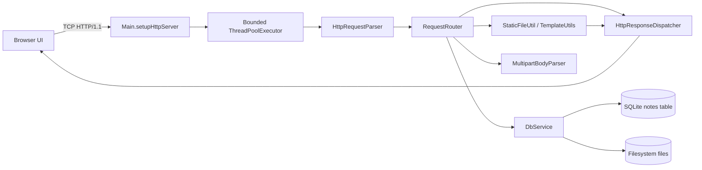
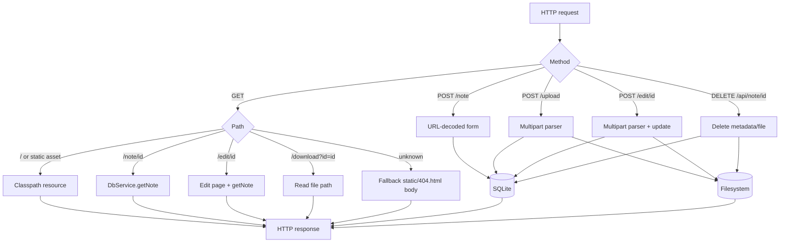
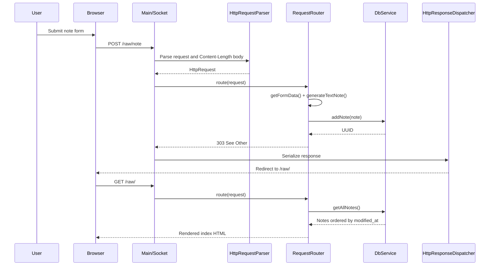
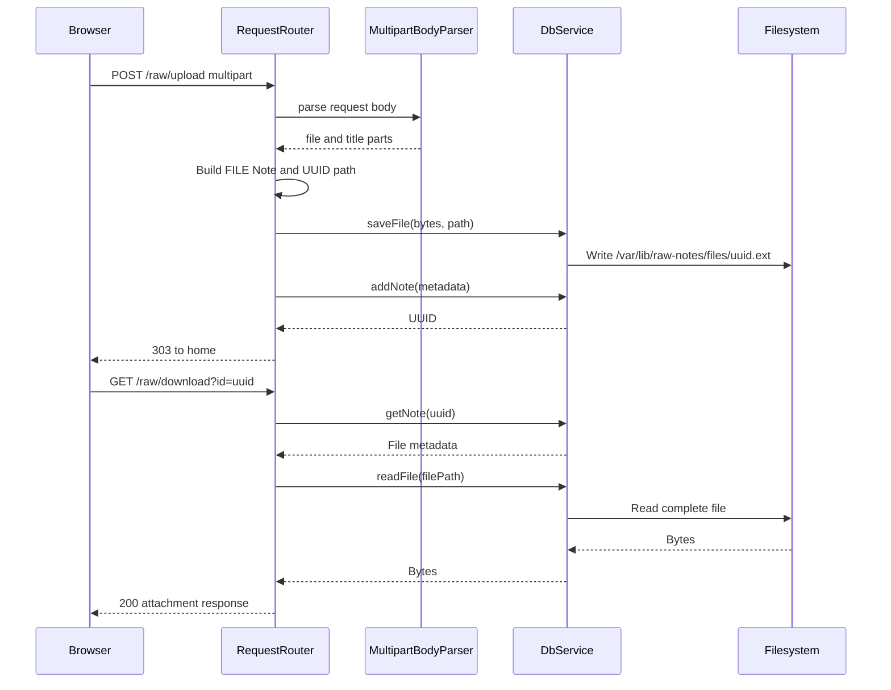

# Raw Notes — Project Documentation

## Table of Contents

- [1. Project Overview](#1-project-overview)
- [2. Features and Functionality](#2-features-and-functionality)
- [3. Technology Stack](#3-technology-stack)
- [4. System Architecture](#4-system-architecture)
- [5. Codebase Structure](#5-codebase-structure)
- [6. Technical Implementation](#6-technical-implementation)
- [7. Data and API Design](#7-data-and-api-design)
- [8. End-to-End Workflows](#8-end-to-end-workflows)
- [9. Security, Performance, and Reliability](#9-security-performance-and-reliability)
- [10. Testing and Deployment](#10-testing-and-deployment)
- [11. Engineering Decisions and Challenges](#11-engineering-decisions-and-challenges)
- [12. Limitations and Future Improvements](#12-limitations-and-future-improvements)
- [13. Resume and Interview Preparation](#13-resume-and-interview-preparation)
- [14. Evidence and Status Legend](#14-evidence-and-status-legend)

## 1. Project Overview

### 1.1 Product identity and purpose

**Raw Notes** is a small, self-contained personal knowledge-capture application implemented as a Java HTTP server. It lets a user create text notes, code snippets, links, and uploaded files; browse them in reverse modification order; open individual detail pages; edit existing content; copy or open content from the list; download files; and delete notes.

The project is also an educational implementation of an HTTP/1.1 server without a web framework. It manually accepts TCP connections, parses request lines and headers, reads request bodies, dispatches requests to route-specific behavior, renders HTML templates, and serializes HTTP responses.

### 1.2 Problem statement

The application addresses a lightweight version of a personal scratchpad problem: a user needs one local place to store raw text, reusable snippets, URLs, and small files without a larger content-management platform. The implementation prioritizes directness and a minimal dependency footprint over production-grade protocol completeness, multi-user access, or operational automation.

### 1.3 Product vision and value proposition

The visible product direction is a fast, low-friction “raw notes” workspace:

- **Capture:** save a titled text note, link, or snippet with one form.
- **Store:** persist note metadata in SQLite and uploaded file bytes on disk.
- **Retrieve:** scan a single list ordered by `modified_at`.
- **Act:** copy text, open links, download files, edit notes, or delete them.
- **Operate locally:** run one shaded Java archive with a fixed local port and filesystem data directory.

The UI uses a deliberately stark “tiny brutalism” visual style: monochrome typography, heavy borders, hard box shadows, and high-contrast action colors.

### 1.4 Target users and use cases

The implementation supports a single implicit user with access to the host running the process. Representative use cases are:

1. Save a paragraph as a `NOTE`.
2. Save source code or a command as a `SNIPPET` and copy it from the list or detail page.
3. Save a URL as a `LINK` and open it from the list or detail page.
4. Upload a file, keep its display title and original filename, and download it later.
5. Edit a note title and either its text content or replacement file.
6. Remove a note and, for file notes, remove the associated file.

There is no implemented user account, tenant, sharing, search, tagging, or permissions model.

## 2. Features and Functionality

### 2.1 Feature matrix

| Feature | Implemented behavior | Inputs | Outputs and side effects |
|---|---|---|---|
| Home/list page | Loads all notes ordered by `modified_at DESC`, renders a row per note | `GET /raw/` | Server-rendered HTML |
| New text note | Accepts title, type, and content; supports `NOTE`, `LINK`, and `SNIPPET` | `POST /raw/note`, URL-encoded body | Inserts SQLite row; redirects to home |
| File upload | Parses multipart form data and stores file bytes under `/var/lib/raw-notes/files` | `POST /raw/upload`, fields `file` and optional `title` | Writes file and SQLite metadata; redirects to home |
| Detail page | Renders type-specific content and metadata | `GET /raw/note/{id}` | Server-rendered HTML |
| Edit | Updates title and text, or replaces an uploaded file | `POST /raw/edit/{id}`, multipart body | Updates SQLite and optionally filesystem; redirects to detail |
| File download | Reads the stored path and sends attachment headers | `GET /raw/download?id={id}` | Binary response with `Content-Disposition` |
| Delete | Deletes a database row and file bytes for file notes | `DELETE /raw/api/note/{id}` | `204 No Content` response |
| Static resources | Serves HTML, CSS, JavaScript, and a fallback page from classpath resources | `GET` paths | Byte response with inferred content type |
| Clipboard/open actions | Browser JavaScript copies note/snippet text, opens links, or navigates to file download | List/detail UI click | Client-side action |

### 2.2 Note types

`NoteType` defines four values:

- `NOTE`: ordinary text, rendered as pre-wrapped paragraph content.
- `SNIPPET`: text rendered inside a `<pre><code>` block.
- `LINK`: text content treated as a URL and rendered as an external link.
- `FILE`: metadata points to file bytes stored outside SQLite.

The new-note form exposes the first three values. Upload creates `FILE` notes. The edit page uses the note type to choose a textarea or file replacement control.

### 2.3 Home/list behavior

`StaticFileUtil.generateHomePage()` loads `static/index.html`, obtains notes from `DbService.getAllNotes()`, and replaces `${NOTES_PLACEHOLDER}` with HTML generated by `TemplateUtils`. The list:

- displays title, an 80-character-or-less preview, and modification time;
- navigates to `note/{id}` when the row body is clicked;
- copies `NOTE` and `SNIPPET` content through `navigator.clipboard`;
- opens `LINK` content in a new browser window;
- navigates to `download?id={id}` for `FILE`;
- invokes `DELETE /api/note/{id}` after browser confirmation.

When there are no notes, the placeholder becomes an “Add Notes to display” alert.

### 2.4 Text-note creation

The `note.html` form sends URL-encoded fields:

```text
title=<title>&type=<NOTE|LINK|SNIPPET>&content=<content>
```

`RequestRouter.getFormData()` splits pairs, URL-decodes keys and values using UTF-8, and stores them in a map. `generateTextNote()` creates a UUID, copies the fields, sets `contentType` to `text/plain`, and stamps creation and modification times with `LocalDateTime.now()`. `DbService.addNote()` inserts the record. The response is a `303 See Other` redirect to the home path.

Required-field validation is primarily delegated to browser HTML attributes. Missing or invalid fields can still reach server code and may produce runtime failures because the route pipeline does not convert arbitrary exceptions to structured `400` or `500` responses.

### 2.5 File upload

The upload form uses `multipart/form-data` with:

- `file`: required browser file input;
- `title`: optional display title.

`MultipartBodyParser` extracts the boundary from the `Content-Type` header, finds boundary markers in the raw byte array, parses each part’s headers, and returns `FormDataBody` objects. `handleUploadNote()` identifies a file part through `filename=`, identifies the title part through `Content-Disposition`, and records:

- a UUID;
- `FILE` type;
- original filename;
- extension-derived path `/var/lib/raw-notes/files/{uuid}.{extension}`;
- byte size;
- multipart content type;
- creation and modification timestamps.

The bytes are written with `DbService.saveFile()` before metadata is inserted. Successful upload redirects to the home page.

### 2.6 Detail pages

`GET /raw/note/{id}` resolves a note and renders `static/note_details.html`. `TemplateUtils.getNoteDetailsTemplate()` selects markup by type:

- `NOTE`: paragraph with copy control;
- `SNIPPET`: code block with copy control;
- `LINK`: external “visit link” button;
- `FILE`: original filename and download button.

The detail page also provides edit and delete controls. The router passes a missing note to the page generator rather than returning a dedicated HTTP `404`; the resulting behavior is therefore template-dependent and should be treated as incomplete error handling.

### 2.7 Editing

`GET /raw/edit/{id}` renders `edit.html`. For text-like notes it provides a title input and textarea. For file notes it shows the existing filename, a current-file download link, and a replacement file input.

`POST /raw/edit/{id}` always parses multipart data. It:

1. Extracts `title`, `content`, and/or `file`.
2. Updates a nonblank title.
3. For a `FILE`, writes replacement bytes to a new extension-derived path and updates file metadata.
4. For other types, updates `textContent`.
5. Updates `modifiedAt`.
6. Calls `DbService.updateNote()`.
7. Redirects to `/raw/note/{id}`.

The old file is not explicitly removed when a file is replaced, so replacement can leave orphaned bytes on disk.

### 2.8 Downloading

`handleDownload()` reads the `id` query parameter, loads the note, reads `note.filePath`, and sends:

```http
HTTP/1.1 200 OK
Content-Type: <stored MIME type>
Content-Length: <stored size>
Content-Disposition: attachment; filename="<original filename>"
```

The entire file is loaded into memory before dispatch. Missing IDs, non-file notes, null paths, and read failures are not consistently converted into a protocol-level error response.

### 2.9 Deletion

The browser sends `DELETE /raw/api/note/{id}`. `DbService.deleteNote()` first loads the note, deletes its file if its type is `FILE`, then deletes the database row. The router returns `204 No Content` with `Content-Length: 0`.

The operation is not transactional across the database and filesystem. A file deletion or database failure can leave metadata and bytes inconsistent.

## 3. Technology Stack

| Area | Technology | Role |
|---|---|---|
| Language/runtime | Java 21 | Server, parsers, models, services, rendering |
| Build | Apache Maven | Dependency resolution and packaging |
| Packaging | Maven Shade Plugin 3.5.0 | Produces an executable shaded JAR with `dev.mrudul.Main` as the manifest entry point |
| Database | SQLite via Xerial `sqlite-jdbc` 3.51.3.0 | Local note metadata persistence |
| Boilerplate reduction | Lombok 1.18.42 | Generates getters/setters, constructors, and data methods |
| Networking | JDK `ServerSocket`, `Socket`, streams | TCP listener and HTTP message I/O |
| Concurrency | JDK `ThreadPoolExecutor` | Bounded request handling |
| Frontend | HTML, CSS, browser JavaScript | Forms, server-rendered pages, clipboard/navigation/delete actions |
| External frontend asset | Google Fonts import for Roboto Mono | Typography in `tiny-brutalism.css` |
| Storage | Host filesystem | Uploaded file bytes under `/var/lib/raw-notes/files` |

There is no Spring, Jakarta Servlet container, ORM, JSON library, test framework, logging framework, container definition, CI workflow, or migration tool in the repository.

## 4. System Architecture

### 4.1 High-level architecture

The system is a layered but lightweight pipeline:



### 4.2 Request lifecycle

1. `Main.main()` sets `RequestRouter.BASE_PATH` to `/raw` and starts port `12345`.
2. `setupHttpServer()` accepts a socket.
3. The socket is submitted to a pool with 10 core threads, 50 maximum threads, a 100-item queue, and `AbortPolicy`.
4. `handleClient()` creates `HttpRequestParser`, parses one request, routes it, and sends one response.
5. The try-with-resources block closes the input/output streams and socket after handling.

The implementation is effectively one request per connection. It does not implement keep-alive request loops, chunked request decoding, or connection lifecycle headers.

### 4.3 Route/data flow



### 4.4 Rendering architecture

HTML is rendered by string replacement rather than a template engine:

- static page files contain `${...}` placeholders;
- `StaticFileUtil` replaces page-level values;
- `TemplateUtils` generates note rows and type-specific content;
- `HttpResponseDispatcher` writes status line, headers, blank line, and body bytes.

This keeps dependencies small but provides no formal template validation or context-aware escaping system.

## 5. Codebase Structure

### 5.1 Directory tree

```text
.
├── .gitignore
├── .idea/
├── pom.xml
├── todo.txt
└── src/
    └── main/
        ├── java/dev/mrudul/
        │   ├── Main.java
        │   ├── model/
        │   │   ├── CommonHeaders.java
        │   │   ├── FormDataBody.java
        │   │   ├── Header.java
        │   │   ├── HttpRequest.java
        │   │   ├── HttpResponse.java
        │   │   ├── Note.java
        │   │   └── NoteType.java
        │   ├── parser/
        │   │   ├── HttpRequestParser.java
        │   │   ├── HttpResponseDispatcher.java
        │   │   └── MultipartBodyParser.java
        │   ├── service/
        │   │   ├── DbService.java
        │   │   └── RequestRouter.java
        │   └── util/
        │       ├── ResourceLoaderUtil.java
        │       ├── StaticFileUtil.java
        │       └── TemplateUtils.java
        └── resources/static/
            ├── 404.html
            ├── edit.html
            ├── index.html
            ├── note.html
            ├── note_details.html
            ├── upload.html
            ├── css/tiny-brutalism.css
            └── js/script.js
```

### 5.2 Important files and responsibilities

| File | Responsibility |
|---|---|
| `src/main/java/dev/mrudul/Main.java` | Process entry point, listener, socket acceptance, executor, request pipeline |
| `service/RequestRouter.java` | Path normalization, method dispatch, CRUD workflows, redirects, content types |
| `service/DbService.java` | SQLite initialization, CRUD, timestamp mapping, file read/write/delete |
| `parser/HttpRequestParser.java` | Raw request line/header/body parsing and unused request serialization |
| `parser/MultipartBodyParser.java` | Boundary discovery and byte-oriented multipart splitting |
| `parser/HttpResponseDispatcher.java` | Raw HTTP response serialization |
| `util/StaticFileUtil.java` | Static bytes and server-side HTML page generation |
| `util/TemplateUtils.java` | Note previews, list rows, edit/detail fragments, escaping helpers |
| `model/HttpRequest.java` | HTTP request state and `/raw`-aware URL accessor |
| `model/HttpResponse.java` | HTTP response state and diagnostic formatter |
| `model/Note.java` / `NoteType.java` | Domain model and supported note categories |
| `resources/static/*.html` | User-facing pages and forms |
| `resources/static/css/tiny-brutalism.css` | Shared visual system and utility classes |
| `pom.xml` | Java version, dependencies, and shaded-jar build |
| `todo.txt` | Planned error handling, responsibility separation, fuzzy search, and edit-note work; some items are now partially implemented |

## 6. Technical Implementation

### 6.1 HTTP request parsing

`HttpRequestParser.parseHttpRequest(InputStream)` wraps the socket input in a `BufferedInputStream` and:

1. Reads until LF, ignoring CR.
2. Splits the request line on spaces into method, URL, and protocol.
3. Reads headers until an empty line.
4. Splits each header on `:`.
5. Finds `Content-Length` case-insensitively.
6. Reads exactly that many bytes with `readNBytes`.

Headers are represented as a `HashSet<Header>`. `Header` is a Lombok data class, so equality and hashing are value-based. Header order is not preserved and duplicate same-value headers collapse.

The parser does not validate token counts, header syntax, request protocol, body completeness, transfer encoding, or maximum sizes. `readLine()` also does not explicitly handle end-of-stream (`InputStream.read()` returning `-1`), which can prevent graceful termination on truncated input.

`unparseHttpRequest()` exists but is not used by the server. It writes `request.getRequestBody().toString()` rather than the body bytes, so it is not a correct binary-safe serializer.

### 6.2 HTTP response serialization

`HttpResponseDispatcher.sendResponse()` writes:

```text
<protocol> <status> <reason>\r\n
<header>: <value>\r\n
\r\n
<body bytes>
```

It uses the platform-default charset when encoding the status line and headers, while application-generated text generally uses UTF-8. Response bodies are sent as raw bytes. The dispatcher does not automatically add `Connection`, date, server, or transfer-encoding headers.

### 6.3 URL normalization and static resource lookup

`HttpRequest.getUrl()` removes the configured `/raw` base path from the request path while preserving the query string. `RequestRouter.fixPath()` then:

- maps `/` to `static/index.html`;
- maps `.css` paths to `static/css/...`;
- maps `.js` paths to `static/js/...`;
- prefixes other paths with `static`;
- appends `.html` when no dot is present;
- removes `/note` and `/edit` fragments for dynamic paths;
- checks classpath existence through `ResourceLoaderUtil`.

Missing ordinary resources fall back to `static/404.html`. Dynamic note/edit paths are allowed through for database lookup. `ResourceLoaderUtil` reads classpath resources fully into memory and throws a `RuntimeException` when a resource is absent.

### 6.4 Routing and status behavior

`RequestRouter.route()` branches on exact uppercase method strings:

- `GET`: static pages, note detail/edit pages, download.
- `POST`: new note, upload, edit.
- `DELETE`: note API deletion.
- all other combinations: a `303 See Other` response redirecting to the base path.

The fallback is not a standards-oriented `404` or `405`. The code therefore provides a useful route map but incomplete error semantics, consistent with the concerns recorded in `todo.txt`.

### 6.5 Form and multipart processing

URL-encoded forms are decoded with `URLDecoder.decode(..., UTF_8)`. Multipart handling is deliberately byte-oriented for part bodies, but part headers are decoded as UTF-8 text. The parser recognizes:

- boundary values with or without quotes;
- `Content-Disposition` field names;
- `filename`;
- per-part `Content-Type`.

The boundary search is a straightforward nested byte scan. It is easy to understand and avoids a library dependency, but it is not a complete RFC-compliant multipart implementation and has no size limits.

### 6.6 Persistence model

`DbService` initializes `/var/lib/raw-notes/files`, opens `jdbc:sqlite:/var/lib/raw-notes/my.db`, and creates the `notes` table if absent. Timestamp values are persisted as `LocalDateTime.toString()` and reconstructed with `LocalDateTime.parse()`.

CRUD methods use prepared statements for note identifiers and values:

- `addNote(Note)` inserts all model fields.
- `getNote(String)` fetches one row.
- `getAllNotes()` orders by `modified_at DESC`.
- `updateNote(Note)` updates mutable fields.
- `deleteNote(String)` deletes a file for `FILE` notes and then deletes the row.

The connection is created once in the `RequestRouter`’s `DbService` and shared by worker threads. Statements and result sets are not consistently closed, and there is no explicit transaction around multi-step file/database operations.

### 6.7 Domain model

`Note` contains:

```text
id, type, title, textContent, contentType,
sizeBytes, filePath, originalFileName,
createdAt, modifiedAt
```

Text-like notes use `textContent`; file notes use `filePath`, `originalFileName`, `contentType`, and `sizeBytes`. The model intentionally allows many fields to be null depending on type.

### 6.8 Server-side templates and escaping

`TemplateUtils` centralizes list and detail fragments. It:

- truncates previews over 80 characters to 77 characters plus `...`;
- replaces newlines for list previews;
- HTML-escapes titles/previews for list content;
- applies limited JavaScript escaping to raw content placed in `data-content`;
- formats timestamps as `dd/MM/yyyy HH:mm`.

`StaticFileUtil.generateNotePage()` and `generateEditPage()` perform direct placeholder replacement. Some detail-template placeholders such as `${TEXT_CONTENT_ESC}` are not replaced by these methods, so the copy control may not receive the intended escaped content. Direct string templating also requires careful context-specific escaping for all future fields.

### 6.9 Concurrency and resource lifecycle

The listener accepts connections serially, but request handling is delegated to a bounded executor:

```text
core threads: 10
maximum threads: 50
queue capacity: 100
keep-alive: 60 seconds
rejection policy: AbortPolicy
```

Each task closes its streams through try-with-resources. There is no explicit executor shutdown path, graceful server stop, socket read timeout, or backpressure response when the queue is full. SQLite access and shared mutable routing state are not explicitly synchronized.

## 7. Data and API Design

### 7.1 SQLite schema

`DbService.setupSqliteDB()` creates:

```sql
CREATE TABLE IF NOT EXISTS notes (
    id TEXT UNIQUE PRIMARY KEY,
    type TEXT NOT NULL,
    title TEXT NOT NULL,
    text_content TEXT,
    content_type TEXT NOT NULL,
    file_path TEXT,
    original_file_name TEXT,
    created_at TEXT NOT NULL,
    modified_at TEXT NOT NULL,
    size_bytes INTEGER
);
```

There are no foreign keys, indexes beyond the primary key, migrations, uniqueness constraints on titles, or separate tables for files/tags/users.

### 7.2 HTTP endpoints

The effective base path configured by `Main.main()` is `/raw`; examples below include it.

| Method | Path | Purpose | Request | Success |
|---|---|---|---|---|
| `GET` | `/raw/` | Home/list | None | `200`, HTML |
| `GET` | `/raw/note` | New-note form | None | `200`, HTML |
| `POST` | `/raw/note` | Create text/link/snippet | URL-encoded `title`, `type`, `content` | `303` to home |
| `GET` | `/raw/upload` | Upload form | None | `200`, HTML |
| `POST` | `/raw/upload` | Create file note | Multipart `file`, optional `title` | `303` to home |
| `GET` | `/raw/note/{id}` | Detail page | UUID-like ID | `200`, HTML in normal case |
| `GET` | `/raw/edit/{id}` | Edit form | ID | `200`, HTML in normal case |
| `POST` | `/raw/edit/{id}` | Update note | Multipart title/content/file | `303` to detail |
| `GET` | `/raw/download?id={id}` | Download file | Query `id` | `200`, binary attachment |
| `DELETE` | `/raw/api/note/{id}` | Delete note | ID in path | `204` |
| `GET` | static asset paths | CSS/JS/404 resources | None | `200`, resource bytes |

The code does not define JSON request or response formats. The delete route is API-shaped but returns no JSON body.

### 7.3 Response shapes

Normal HTML responses include an inferred `Content-Type` and `Content-Length`. File downloads use stored MIME type and original filename. Redirects use `Location` and `Content-Length: 0`; some redirect helpers also assign a body despite the zero length, which is an internal protocol inconsistency.

## 8. End-to-End Workflows

### 8.1 Create a text note



### 8.2 Upload and later download a file



### 8.3 Edit a note

1. Browser requests `GET /raw/edit/{id}`.
2. Router loads the note and `StaticFileUtil` builds the edit page.
3. Browser submits multipart form data.
4. Router parses all parts and applies title/content/file changes.
5. File replacement writes new bytes before metadata update.
6. `DbService.updateNote()` persists changed columns and modification time.
7. Router redirects to the detail page.

### 8.4 Delete a note

1. Browser confirmation is shown.
2. JavaScript sends `DELETE /raw/api/note/{id}`.
3. Router calls `DbService.deleteNote()`.
4. File notes remove their path if present.
5. SQLite row is deleted.
6. Browser reloads or redirects to the list.

## 9. Security, Performance, and Reliability

### 9.1 Security posture

Implemented protections and positive choices:

- SQL values and identifiers are passed through prepared statements.
- List titles and previews receive HTML escaping in `TemplateUtils`.
- Uploaded file storage uses generated UUIDs rather than using the client filename as the storage basename.
- The stored path is generated under a fixed application directory.

Important risks and missing controls:

- There is no authentication or authorization; anyone able to reach the port can read, modify, download, or delete all data.
- The server binds a `ServerSocket` without an explicit bind address; deployment exposure depends on host networking defaults.
- Request headers and bodies have no size limits, enabling memory exhaustion.
- Downloads load complete files into memory.
- Filename, MIME type, and URL content are accepted from clients and inserted into headers or HTML contexts with incomplete contextual escaping.
- `target="_blank"` links do not include `rel="noopener"`.
- No CSRF protection exists for mutation forms or delete requests.
- No HTTPS/TLS support exists.
- Client-side delete handling generally treats any HTTP response as success.

### 9.2 Performance characteristics

The application is suitable for small local workloads:

- static resources are read fully into memory;
- request bodies are buffered fully;
- multipart parsing scans the body with nested loops;
- SQLite queries are simple and use a primary-key lookup for IDs;
- home-page rendering performs one query and string concatenation per note;
- file downloads read the whole file before responding.

The bounded executor prevents unlimited task creation, but the queue and `AbortPolicy` can reject requests under load. There are no metrics, profiling hooks, response compression, pagination, caching, or streaming I/O.

### 9.3 Reliability and failure behavior

The code catches `IOException` at the socket handler and prints the message. Many other failures propagate from routing, parsing, database, or file operations without a centralized conversion to HTTP responses. The project’s `todo.txt` explicitly identifies the desired future mapping:

```text
BadRequestException          -> 400
NotFoundException            -> 404
MethodNotAllowedException    -> 405
ServerFailureException       -> 500
```

Actual behavior currently includes fallback redirects and fallback HTML, and may expose connection-level failure for malformed input or runtime exceptions.

## 10. Testing and Deployment

### 10.1 Tests and validation status

No `src/test` directory, test classes, test dependencies, or test plugins are present in the repository. The repository therefore documents no automated unit, integration, protocol, browser, or load test suite.

The expected build command is:

```bash
mvn package
```

During documentation generation, Maven was not installed in the execution environment (`mvn: command not found`), so the build could not be run here. This is an environment limitation, not evidence that the project fails to compile.

### 10.2 Build and artifact

`pom.xml` targets Java 21 and uses the Maven Shade Plugin. The shaded artifact is configured with:

```text
Main-Class: dev.mrudul.Main
```

The intended runtime shape is therefore:

```bash
java -jar <shaded-artifact>.jar
```

The exact generated filename depends on Maven’s artifact naming and was not verified because Maven is unavailable.

### 10.3 Runtime prerequisites

A deployment host needs:

- Java 21 runtime;
- permission to bind port `12345`;
- permission to create and write `/var/lib/raw-notes`;
- permission to create `/var/lib/raw-notes/files`;
- sufficient storage for the SQLite database and uploads.

The application creates the data directories at startup through `DbService`, but does not create an operating-system user, service unit, container, backup process, or migration process.

### 10.4 Configuration

The current runtime configuration is hard-coded:

| Setting | Value | Location |
|---|---|---|
| HTTP port | `12345` | `Main.main()` |
| URL base path | `/raw` | `Main.main()` |
| SQLite database | `/var/lib/raw-notes/my.db` | `DbService` |
| File directory | `/var/lib/raw-notes/files` | `DbService` |
| Worker core/max | `10` / `50` | `Main` |
| Queue capacity | `100` | `Main` |

There are no environment variables, command-line options, application properties, secrets, or external service configuration.

### 10.5 Logging and monitoring

Diagnostics use `System.out.println`, including connection details and upload messages. There is no structured logging, log level control, log rotation, audit trail, health endpoint, metrics, tracing, or monitoring integration.

## 11. Engineering Decisions and Challenges

### 11.1 Deliberate low-level HTTP implementation

The project chooses JDK sockets and custom parsers instead of a framework. This makes the HTTP lifecycle visible and keeps the dependency set small, but transfers responsibility for syntax validation, limits, persistent connections, error mapping, and protocol correctness to application code.

### 11.2 Hybrid persistence for notes and files

SQLite stores searchable metadata and filesystem storage holds binary content. This avoids putting large file blobs in the database and makes downloads straightforward. The trade-off is that database and filesystem changes are not atomic, so cleanup, replacement, backup, and recovery need additional design.

### 11.3 Server-side HTML generation

The project renders pages on the server and keeps browser JavaScript small. This reduces frontend build complexity and makes the application runnable from a single Java artifact. The trade-off is manual placeholder replacement, limited escaping guarantees, and duplicated presentation concerns between Java and HTML.

### 11.4 Bounded concurrency

A fixed/bounded executor is a reasonable safeguard compared with creating an unbounded thread per connection. The chosen `AbortPolicy` makes overload explicit at the executor level, but there is no user-visible overload response or graceful shutdown strategy.

### 11.5 Simple content-type and extension handling

Content types are inferred from static filename extensions, while uploaded content type is accepted from multipart metadata. This is easy to implement but does not validate file content and only covers HTML, CSS, JavaScript, and plain-text static resources.

### 11.6 Planned responsibility separation

`todo.txt` describes a future architecture in which parsers only parse, routers only select handlers, services perform business logic, and a top-level pipeline maps exceptions to HTTP responses. The current `RequestRouter` still owns parsing-adjacent form extraction, file workflows, response construction, and error redirects, so this separation is planned rather than complete.

## 12. Limitations and Future Improvements

### 12.1 Explicitly recorded backlog

`todo.txt` lists:

- better error handling and fallback;
- `400`, `404`, `405`, and `500` exception-to-response mapping;
- clearer parser/router/service responsibility boundaries;
- edit-note work (now partially implemented in the current source);
- fuzzy search.

### 12.2 High-value technical improvements

1. Introduce validated request/response abstractions and a single exception-to-status mapping layer.
2. Return real `404`, `405`, and `500` responses instead of redirecting unknown operations.
3. Validate request-line shape, headers, content lengths, methods, content types, and body limits.
4. Handle `HEAD`, `OPTIONS`, persistent connections, timeouts, and chunked transfer encoding if broader HTTP compatibility is required.
5. Close JDBC resources consistently and use transactions for metadata/file coordination where possible.
6. Add migration/version management for the SQLite schema.
7. Stream file uploads/downloads and enforce configurable maximum sizes.
8. Use a safe path strategy and validate file extensions and MIME types.
9. Remove or clean up old files during replacement and add orphan-file reconciliation.
10. Replace string substitution with a context-aware templating approach or rigorously define escaping per HTML, attribute, and JavaScript context.
11. Add authentication, authorization, CSRF defenses, HTTPS termination, and security headers for non-local deployment.
12. Add unit tests for parsers, multipart boundaries, form decoding, routing, template escaping, and database CRUD.
13. Add integration tests that run the server against an isolated temporary data directory.
14. Add pagination or search indexes before scaling the home page to large note counts.
15. Make port, base path, storage path, and executor settings configurable.
16. Add structured logging, health checks, metrics, graceful shutdown, and backups.

## 13. Resume and Interview Preparation

### 13.1 Resume bullet candidates

These bullets describe implemented work without inventing performance metrics:

1. Built a Java 21 HTTP/1.1 server from raw `ServerSocket`/`Socket` primitives, including custom request parsing, response serialization, routing, and classpath static-resource delivery.
2. Implemented a SQLite-backed personal notes application supporting typed notes, code snippets, links, file uploads, editing, downloads, and deletion.
3. Designed a hybrid persistence model that stores note metadata in SQLite and uploaded binary content on the filesystem with UUID-based storage paths.
4. Added multipart/form-data parsing with boundary detection, per-part headers, filenames, MIME types, and binary-safe part bodies without a web framework.
5. Added bounded request concurrency using a `ThreadPoolExecutor` with configurable core/max capacity, queueing, and rejection behavior.
6. Implemented server-rendered HTML templates for list, detail, edit, upload, and create-note workflows with type-specific presentation and content previews.
7. Used prepared SQL statements for note CRUD operations and modeled note lifecycle metadata with UUIDs and `LocalDateTime` timestamps.
8. Created a minimal shaded Maven artifact with Java 21 compilation and `dev.mrudul.Main` as the executable entry point.

### 13.2 Engineering contributions and technologies demonstrated

- Java 21 language and standard-library networking.
- TCP socket lifecycle and HTTP message framing.
- Custom parsers for request headers, URL-encoded forms, and multipart bodies.
- Thread-pool sizing and bounded work queues.
- SQLite schema initialization and prepared-statement CRUD.
- Filesystem APIs for binary persistence.
- Server-side rendering and template composition.
- Browser APIs for clipboard, navigation, fetch-based deletion, and forms.
- Maven dependency and shaded-JAR packaging.
- Practical reasoning about protocol edge cases, escaping, resource limits, and consistency boundaries.

### 13.3 Likely technical interview questions and answer outlines

1. **Why use a thread pool instead of one thread per connection?**  
   The pool bounds concurrent work and memory usage. This implementation uses 10 core threads, 50 maximum threads, a 100-item queue, and `AbortPolicy`; it still needs a graceful overload response and shutdown policy.

2. **How does the server know how many body bytes to read?**  
   `HttpRequestParser` searches for `Content-Length` and calls `readNBytes(length)`. It does not implement chunked transfer encoding or robust incomplete-body validation.

3. **How are uploaded files represented?**  
   Metadata is stored in the `notes` table; bytes are stored at a UUID-derived path under `/var/lib/raw-notes/files`. The note retains MIME type, original filename, size, and path.

4. **What are the consistency risks of SQLite plus filesystem storage?**  
   File and row changes are separate operations. A failure between them can leave orphaned files or rows pointing to missing files; transactions alone cannot atomically cover ordinary filesystem writes.

5. **How does multipart parsing work?**  
   The parser extracts `boundary=` from `Content-Type`, locates first/middle/final boundary byte sequences, splits parts, parses headers, and preserves part bodies as bytes.

6. **How does routing distinguish dynamic pages from static resources?**  
   `HttpRequest.getUrl()` removes `/raw`; `fixPath()` maps `/`, CSS, JS, and extensionless paths into classpath resource names. Note and edit paths are then resolved through database lookups.

7. **What HTTP error behavior would you improve first?**  
   Centralize exception handling and map malformed input to `400`, missing resources/notes to `404`, wrong methods to `405`, and unexpected failures to `500`. The current fallback frequently redirects with `303`.

8. **What concurrency issue exists around database access?**  
   One JDBC connection is shared across request threads, while statement/result-set cleanup is inconsistent. A safer design would define connection ownership or a pool and use transactions around related operations.

9. **How is output escaping handled?**  
   `TemplateUtils.escape()` HTML-escapes list values and `escapeJs()` partially escapes raw content for attributes. Escaping is not fully context-aware, and unresolved detail-page placeholders show why centralized safe templating is important.

10. **How would you test this system?**  
    Unit-test request parsing, URL normalization, form decoding, multipart boundaries, template escaping, and note mapping; use temporary SQLite/filesystem integration tests; then exercise endpoint sequences with a real socket client and malformed/oversized inputs.

### 13.4 Thirty-second explanation

“Raw Notes is a small Java 21 personal knowledge server built without a web framework. It accepts HTTP connections over `ServerSocket`, parses requests manually, routes server-rendered HTML workflows, stores note metadata in SQLite, and stores uploaded files on disk. It supports notes, snippets, links, uploads, edits, downloads, and deletion, with a bounded thread pool for concurrent clients. The interesting engineering trade-off is keeping the system dependency-light while implementing protocol parsing, multipart handling, persistence, rendering, and failure behavior directly.”

### 13.5 Two-minute explanation

“The project is a self-contained raw-notes application and an exercise in building an HTTP server from the Java standard library. `Main` listens on port 12345, configures the `/raw` base path, accepts sockets, and dispatches each connection to a bounded `ThreadPoolExecutor`. `HttpRequestParser` reads the request line, headers, and a `Content-Length`-delimited body. `RequestRouter` maps GET, POST, and DELETE requests to static pages, note CRUD operations, uploads, edits, downloads, and the delete API. HTML is rendered with classpath templates and Java string replacement, while `TemplateUtils` creates type-specific list and detail fragments.

“The domain supports four note types: ordinary notes, snippets, links, and files. SQLite stores note metadata, timestamps, MIME information, and file paths; uploaded bytes are stored under `/var/lib/raw-notes/files` using UUID-based names. Multipart forms are parsed by a custom byte-oriented boundary parser. The project demonstrates networking, protocol framing, concurrency, prepared SQL, filesystem I/O, server-side rendering, and browser integration without Spring or a servlet container.

“The main production gaps are deliberate areas for improvement: incomplete HTTP validation, no authentication, no body limits or streaming, shared JDBC connection usage, non-atomic database/filesystem updates, manual escaping, and decentralized error handling. The repository’s own backlog identifies a future exception-to-status pipeline, clearer parser/router/service separation, and fuzzy search.”

## 14. Evidence and Status Legend

### 14.1 Implemented

The following are directly represented in source and resources:

- Java socket listener and bounded executor.
- Manual HTTP request parsing and response dispatch.
- SQLite schema creation and note CRUD.
- Text, snippet, link, and file note model.
- Server-rendered list, detail, create, upload, and edit pages.
- File storage, download, replacement, and deletion paths.
- Browser clipboard, link-opening, and delete actions.
- Maven Java 21 and shaded-JAR configuration.

### 14.2 Partially implemented or behaviorally incomplete

- Error handling exists as fallback redirects/resource pages rather than a complete status model.
- Edit support exists but has file-replacement cleanup and validation gaps.
- Escaping exists for several list contexts but is not uniformly context-aware.
- The executor is bounded but has no graceful shutdown or overload response.
- File/database persistence works as two separate operations.

### 14.3 Planned or explicitly listed

- Central exception classes and HTTP status conversion.
- Responsibility separation between parser, router, services, and pipeline.
- Fuzzy search.

### 14.4 Not found in the repository

No implementation was found for:

- authentication, authorization, users, roles, or sessions;
- JSON API contracts;
- automated tests;
- CI/CD workflows;
- Docker/container deployment;
- environment-based configuration;
- structured logging or monitoring;
- caching, pagination, or search.

These absences are repository observations, not claims that such functionality could not exist outside the checked-in project.
